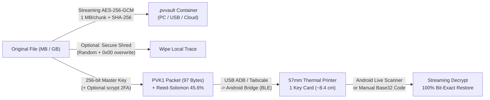

<p align="center">
  
  &nbsp;&nbsp;&nbsp;&nbsp;
  
</p>

<h1 align="center">PAPER-VOID — Thermal Paper-Key File Vault</h1>

<p align="center">
  <b>Turn an affordable 57mm mini thermal printer into a true Air-Gapped AES-256-GCM Physical Key Vault</b><br/>
  <i>Hybrid Paper-Key File Encryption • Optical Reed-Solomon (`PV-RIBBON v1`) • Android Live Camera Scanner</i>
</p>

<p align="center">
  <b>English</b> &nbsp;|&nbsp; <a href="README.vi.md">Tiếng Việt</a> &nbsp;|&nbsp; <a href="README.zh-CN.md">简体中文</a>
</p>

---

## 1. Overview

**PAPER-VOID** is a **Hybrid Paper-Key Vault** system that cleanly separates **encrypted ciphertext (`.pvvault`)** from the **physical decryption key printed on thermal paper** — instead of printing entire files onto meters of paper:

- Any file (from kilobytes to multi-gigabyte archives) is encrypted via **streaming AES-256-GCM (`1 MB` chunks)** into a `.pvvault` file that can be stored safely on your PC, USB drive, NAS, or Cloud storage.
- The random 256-bit Master Key (with optional offline `scrypt` 2FA passphrase) is encoded into **one single ~8.4 cm (`384 × 670 px`) Key Card** printed on a 57mm mini thermal printer:
  - **`PV-RIBBON v1` Optical Tile**: Built specifically for 203 DPI thermal printers with **2-way interleaved Reed-Solomon (`RS(158, 86)`, `45.6%` redundancy)** and a SHA-256 CTR whitening mask — resilient against wrinkles, fading, skew, low light, and 180° upside-down scans.
  - **3-line Human-Readable Base32 + CRC-16 Recovery Code**: Printed underneath as a guaranteed manual fallback even without a camera.
- Includes the companion **Android Bridge & Live Scanner (`TinyPrint Bridge`)** working over **USB cable (ADB auto-forward)** or **LAN / Tailscale VPN (`0.0.0.0:9100`)**, providing both BLE printing and a dedicated full-screen camera scanner with animated zoom-corner brackets and instant **`✔ KEY RECEIVED`** haptic feedback.



---

## 2. Key Features

- **Large-File Streaming Encryption (`AES-256-GCM`)**: Processes `1 MB` chunks with low RAM overhead, atomic `.part` writes, per-chunk authentication tags, and full-file `SHA-256` integrity verification.
- **True Offline 2FA (Optional)**: Wraps the 256-bit Master Key with `scrypt` (`N=2^15, r=8, p=1`, 128-bit random salt). An attacker must possess **both the physical paper slip AND your memorized passphrase**.
- **Ultra Paper-Efficient**: Whether encrypting a 50 KB note or a 10 GB archive, it always prints **exactly 1 Key Card (~8.4 cm)**.
- **Direct Phone Live Scanner (USB ADB or Tailscale)**: No PC webcam required, no manual photo transfers.
- **One-Click Bridge Control**: Start or completely shut down `TinyPrint Bridge` on your phone directly from the desktop UI or Android notification bar.
- **Secure Shred**: Overwrites original files with random bytes + `0x00` and randomizes filenames before deletion.
- **100% Offline & Open-Source**: Zero accounts, zero cloud dependencies, zero telemetry.

---

## 3. Supported Thermal Printers

PAPER-VOID targets the standard **`384 px` (57mm / 203 DPI)** thermal width:

| Category | Example Models | Protocol / Width | Support Status |
| :--- | :--- | :--- | :--- |
| **Hardware Verified** | **TinyPrint X5** (`MXW01` series) | BLE `MXW01` (`0x22 0x21`, 384 px / 57mm) | ✅ **100% Verified** (tuned heat energy & feed pacing) |
| **MXW01-Compatible Mini Printers** | **MX06, MX08, MX10, MX11** & mini printers using *TinyPrint / FunPrint / WalkPrint* (BLE UUID `AE30` / `AE01`) | BLE `MXW01` (`384 px` / 57mm) | ✅ **Compatible** (set Bluetooth name in Printer tab) |
| **Classic Cat Printers** | **GB01, GB02, GB03, GT01, MX05** | Classic BLE (`0x51 0x78`, 384 px / 57mm) | 🟡 **Supported via Classic BLE driver** |
| **Any Standard Printer** | Office laser/inkjet, USB POS receipt printers | Export `384 × 670 px` PNG Key Card | ✅ **100% Supported** |

### System Requirements
- **Desktop**: Windows 10/11 (64-bit) — run standalone `PAPER-VOID.exe` or Python 3.12+ from source.
- **Android Companion** *(for BLE printing & Live Scanner)*: Android 8.0+ with BLE; enable **USB Debugging** (USB mode) or connect via same Wi-Fi / **Tailscale** (wireless mode on port `:9100`).

---

## 4. Security Comparison

| Criteria | **PAPER-VOID (Hybrid Paper-Key)** | Password ZIP / 7-Zip | BitLocker / VeraCrypt | Cloud Password Manager | Google Authenticator (TOTP) | YubiKey / Hardware Key |
| :--- | :---: | :---: | :---: | :---: | :---: | :---: |
| **Primary Purpose** | **Air-Gapped File Encryption** | Password file archive | Full disk / volume encryption | Cloud secrets / file vault | 2FA login OTP | FIDO2 / PGP hardware token |
| **Does the key touch Disk / Cloud?** | **NO** (physical paper only) | Not stored, vulnerable to weak passwords | Stored in encrypted header | Encrypted on 3rd-party servers | Stored on phone / cloud | Stored in secure element |
| **Resilience vs. Remote PC Compromise (RAT / Malware)** | **Very High** — `.pvvault` is useless without the physical card | Medium — keylogger captures password | Medium — keylogger / RAM dump while mounted | Low–Medium — stolen session or master pass exposes all | Not for file encryption | Very High (requires separate encryption app) |
| **Brute-Force Resistance** | **Cryptographic (`2^256` + `scrypt` 2FA)** | Depends on password entropy | Very High (with strong password) | Very High | N/A | Cryptographic |
| **Hardware Cost** | **Very Low (~$8–$15)** | Free | Free | Subscription / Freemium | Free | High (~$50–$100+) |
| **Main Trade-off** | Thermal paper fades over years *(see Section 6)* | Forgotten password = permanent loss | Lost password / corrupt header = loss | Third-party vendor trust | Lost device without backup | Lost/damaged USB key |

---

## 5. Target Audience & Benefits

### Who Is This For?
- **Privacy-Conscious Individuals & Cold-Storage Users**: Protect crypto seed backups, SSH/PGP private keys, legal contracts, identity scans, or personal archives offline.
- **Developers, DevOps & InfoSec Enthusiasts**: Transparent, auditable cryptography (`AES-256-GCM` + `scrypt` + `Reed-Solomon`) with zero vendor lock-in.
- **Mini Thermal Printer Owners**: Turn an inexpensive pocket printer into a practical physical security device.
- **Safe Family / Small-Team Handoff**: Store `.pvvault` freely on Google Drive or USB while sealing the paper key inside a physical safe.

### Key Benefits
1. **True Physical Air-Gap**: Even if your `.pvvault` file leaks online, it remains computationally unbreakable without the paper slip in your wallet or safe.
2. **Fast & Economical**: ~5 seconds to print a Key Card, ~2 seconds to scan and decrypt via phone.
3. **Anti Lock-In Recovery**: Recovers up to `45.6%` optical damage automatically via Reed-Solomon, plus a **3-line Base32 code** for manual recovery if no camera is available.

---

## 6. Thermal Paper Longevity & SSD Shred Notice

- **Thermal Paper Preservation**: Standard thermal paper can fade over 6 months – 3 years under heat, sunlight, or friction. For long-term cold storage:
  1. Print **2 copies** and store them in dark sealed bags in separate cool places; or
  2. Use **archival BPA-free thermal paper (10-year rated)**; or
  3. Hand-copy the **3-line Base32 recovery code** with a ballpoint pen onto regular paper.
- **Secure Shred on SSDs**: File overwriting is thorough on mechanical HDDs. On SSDs with wear-leveling, remnants may persist in unmapped blocks until the OS issues `TRIM` — pairing with full-disk encryption (e.g. **BitLocker**) is recommended.

---

## 7. Repository Structure & Quick Start

```text
├── assets/                   # Desktop & Android Bridge icons
├── paper_void/               # Windows Desktop App (Python + Tkinter + OpenCV)
│   ├── app.py                # Main GUI
│   ├── vault.py              # Streaming AES-256-GCM + scrypt 2FA + Key Card renderer
│   ├── codec.py              # PV-RIBBON v1 optical codec (Reed-Solomon 45.6%) + Shred
│   ├── scanner.py            # 5-pass OpenCV decoder (photo / video / live frame)
│   └── printer_ble.py        # MXW01 / Classic BLE driver + ADB / Tailscale bridge client
├── android/                  # Android Companion App (TinyPrint Bridge + Live Scanner)
│   ├── src/com/tinyprint/bridge/
│   │   ├── BleBridgeService.java
│   │   ├── BridgeActivity.java
│   │   └── ScannerActivity.java
│   └── build_and_install.ps1 # Pure Android SDK build script (no Gradle needed)
├── README.md                 # English
├── README.vi.md              # Tiếng Việt
└── README.zh-CN.md           # 简体中文
```

### Run Desktop App from Source (Windows)
```powershell
pip install -r paper_void/requirements.txt
py -3.12 paper_void/app.py
```

### Build & Install Android Bridge APK
```powershell
powershell -ExecutionPolicy Bypass -File android/build_and_install.ps1
```
