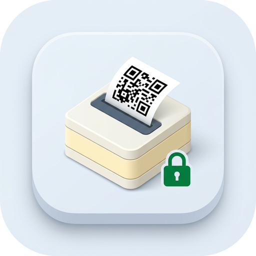
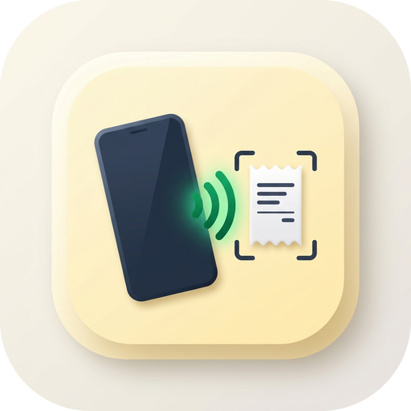
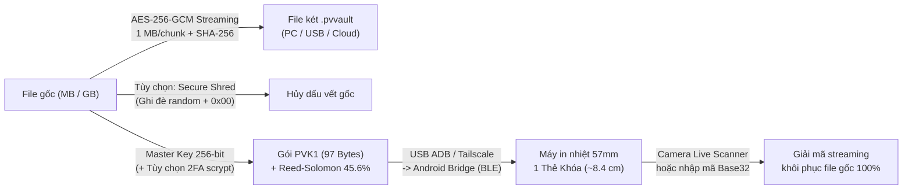

<p align="center">
  
  &nbsp;&nbsp;&nbsp;&nbsp;
  
</p>

<h1 align="center">PAPER-VOID — Thermal Paper-Key File Vault</h1>

<p align="center">
  <b>Biến máy in nhiệt mini 57mm giá rẻ thành két khóa vật lý Air-Gapped chuẩn AES-256-GCM</b><br/>
  <i>Air-Gapped Physical Paper-Key File Encryption Vault powered by 57mm Mini Thermal Printers & Android Live Optical Scanner</i>
</p>

---

## 1. Giới thiệu tổng quan

**PAPER-VOID** là hệ thống mã hóa file theo kiến trúc **Hybrid Paper-Key Vault**: thay vì in toàn bộ dữ liệu lên giấy (tốn hàng mét giấy và giới hạn vài chục KB), phần mềm tách biệt hoàn toàn **Dữ liệu mã hóa (`.pvvault`)** và **Chìa khóa vật lý trên giấy in nhiệt**:

- File gốc dung lượng bất kỳ (từ vài KB đến nhiều GB) được mã hóa streaming bằng **AES-256-GCM (1 MB/chunk)** ra file `.pvvault` (có thể lưu an toàn trên PC, USB, NAS, hoặc Google Drive).
- Chìa khóa giải mã 256-bit (kèm tùy chọn mật khẩu phụ 2FA `scrypt`) được đóng gói thành **1 Thẻ Khóa duy nhất dài ~8.4 cm (`384 × 670 px`)** in ra máy in nhiệt mini 57mm:
  - **Mã quang học `PV-RIBBON v1`** với thuật toán sửa lỗi **Reed-Solomon 2 chiều (`RS(158, 86)`, dư thừa `45.6%`)** + SHA-256 CTR whitening mask — chịu nhăn, mờ, nghiêng, thiếu sáng và lật ngược 180°.
  - **3 dòng mã chữ số Base32 + kiểm tra lỗi CRC-16** in kèm dưới đáy thẻ để nhập tay cứu hộ khi không có camera.
- Đi kèm ứng dụng **Android Companion (`TinyPrint Bridge`)** hoạt động qua **cáp USB (ADB)** hoặc **mạng LAN / Tailscale VPN**, vừa làm cầu nối Bluetooth BLE in ra máy in nhiệt, vừa mở **màn hình camera quét thẻ chuyên dụng** với hiệu ứng zoom bo viền và xác nhận tức thì **`✔ ĐÃ NHẬN MÃ THẺ`**.



---

## 2. Tính năng nổi bật

- **Mã hóa & giải mã file dung lượng lớn (Streaming AES-256-GCM)**: Xử lý từng khối `1 MB`, ghi atomic qua `.part`, kiểm tra toàn vẹn bằng auth tag + `SHA-256` toàn file.
- **Bảo mật 2 yếu tố hoàn toàn Offline (2FA)**: Tùy chọn bọc Master Key bằng `scrypt` (`N=2^15, r=8, p=1`, salt 128-bit) — kẻ tấn công phải có **đồng thời tờ giấy vật lý + mật khẩu trong đầu bạn**.
- **Siêu tiết kiệm giấy**: File 1 MB hay 10 GB đều chỉ tốn đúng **1 mảnh thẻ dài ~8.4 cm**.
- **Quét thẻ trực tiếp bằng điện thoại (USB ADB hoặc Tailscale)**: Không cần webcam PC, không cần chụp ảnh thủ công rồi chép qua máy tính.
- **Điều khiển Bridge chủ động**: Bật/tắt `TinyPrint Bridge` trên điện thoại ngay từ giao diện PC hoặc trực tiếp từ thanh thông báo Android.
- **Hủy file an toàn (Secure Shred)**: Ghi đè dữ liệu ngẫu nhiên + `0x00` + đổi tên ngẫu nhiên trước khi xóa file gốc.
- **100% Offline & Open-Source**: Không tài khoản, không Cloud, không telemetry.

---

## 3. Thiết bị máy in nhiệt hỗ trợ

PAPER-VOID xuất bản in chuẩn **`384 px` (khổ giấy 57mm / 203 DPI)** và hỗ trợ đa giao thức:

| Nhóm thiết bị | Model tiêu biểu | Giao thức / Khổ giấy | Trạng thái |
| :--- | :--- | :--- | :--- |
| **Đã kiểm thử thực tế (Verified)** | **TinyPrint X5** (`MXW01` series) | BLE `MXW01` (`0x22 0x21`, 384 px / 57mm) | ✅ **Hỗ trợ 100%** (tối ưu nhịp đầu nhiệt chống kẹt giấy) |
| **Cùng chipset MXW01** | **MX06, MX08, MX10, MX11**, máy in mini dùng app *TinyPrint / FunPrint / WalkPrint* (BLE UUID `AE30` / `AE01`) | BLE `MXW01` (`384 px` / 57mm) | ✅ **Tương thích trực tiếp** (đổi tên Bluetooth trong tab Máy In) |
| **Cat Printer cổ điển** | **GB01, GB02, GB03, GT01, MX05** | BLE Classic (`0x51 0x78`, 384 px / 57mm) | 🟡 **Hỗ trợ qua driver Classic BLE** |
| **Máy in bất kỳ (Không dùng BLE)** | Máy in văn phòng, máy in hóa đơn POS, máy in nhiệt USB | Xuất ảnh PNG thẻ khóa `384 × 670 px` | ✅ **Hỗ trợ 100%** |

### Yêu cầu hệ thống
- **PC**: Windows 10/11 (64-bit) — chạy trực tiếp `PAPER-VOID.exe` hoặc từ mã nguồn Python 3.12+.
- **Điện thoại Android** *(khi in BLE qua điện thoại & quét camera Live)*: Android 8.0+ có BLE, bật **USB Debugging** (nếu dùng cáp USB) hoặc kết nối cùng Wi-Fi / **Tailscale** (nếu dùng không dây qua cổng `:9100`).

---

## 4. So sánh mức độ an toàn với các phương pháp khác

| Tiêu chí | **PAPER-VOID (Hybrid Paper-Key)** | ZIP / 7-Zip mật khẩu | BitLocker / VeraCrypt | Cloud Password Manager | Google Authenticator (TOTP) | YubiKey / Hardware Key |
| :--- | :---: | :---: | :---: | :---: | :---: | :---: |
| **Mục đích chính** | **Mã hóa file (Khóa giấy Air-Gap)** | Mã hóa file bằng mật khẩu | Mã hóa ổ đĩa / container | Lưu mật khẩu/file lên Cloud | Mã OTP đăng nhập 2FA | Khóa phần cứng FIDO2 / PGP |
| **Khóa có lưu trên ổ đĩa / Cloud?** | **KHÔNG** (chỉ tồn tại trên giấy) | Không lưu, nhưng dễ lộ nếu pass yếu | Lưu header mã hóa trên đĩa | Lưu bản mã hóa trên máy chủ hãng | Seed nằm trên điện thoại / Cloud | Lưu trong chip bảo mật |
| **Chống RAT / Malware chiếm PC từ xa** | **Rất cao** — Không có thẻ giấy thì `.pvvault` vô nghĩa | Trung bình — Keylogger đọc được mật khẩu | Trung bình — Keylogger / dump RAM khi mount | Thấp–TB — Lộ Master Pass / session là mất | Không mã hóa file | Rất cao (cần phần mềm mã hóa đi kèm) |
| **Chống Brute-Force** | **Tuyệt đối** (`2^256` + `scrypt` 2FA) | Phụ thuộc độ mạnh mật khẩu | Rất cao (nếu mật khẩu mạnh) | Rất cao | Không áp dụng | Tuyệt đối |
| **Chi phí phần cứng** | **Rất rẻ** (~150k–250k VNĐ) | Miễn phí | Miễn phí | Thuê bao / Giới hạn | Miễn phí | Cao (~1.2–2.5 triệu VNĐ) |
| **Điểm cần lưu ý** | Giấy nhiệt có thể phai theo thời gian *(xem mục 6)* | Quên mật khẩu = mất dữ liệu | Quên pass / lỗi header = mất | Phụ thuộc dịch vụ bên thứ 3 | Mất máy nếu không backup | Mất / hỏng USB khóa |

---

## 5. Đối tượng hướng tới & Lợi ích khi dùng

### Đối tượng hướng tới
- **Người lưu trữ tài sản số & hồ sơ nhạy cảm**: Lưu lạnh (Cold Storage) bản sao Seed Phrase ví crypto, khóa SSH/PGP, hợp đồng, giấy tờ tùy thân, ảnh/video riêng tư.
- **Lập trình viên, DevOps & Cộng đồng Self-host / InfoSec**: Cần công cụ mã hóa mã nguồn mở, thuật toán minh bạch, không phụ thuộc máy chủ ngoài.
- **Người sở hữu máy in nhiệt mini (TinyPrint X5 / Cat Printer)**: Biến chiếc máy in mini ~200k thành thiết bị tạo khóa vật lý Air-Gapped thực thụ.
- **Sao lưu & bàn giao dữ liệu an toàn trong gia đình / nhóm nhỏ**: File `.pvvault` để công khai trên Google Drive/USB, còn tờ giấy khóa niêm phong cất trong két sắt vật lý.

### Lợi ích nổi bật
1. **Cách ly vật lý thực sự (True Air-Gap)**: Bị lộ file `.pvvault` trên mạng hay mất USB cũng không ai giải mã được nếu không có mảnh giấy vật lý trong tay bạn.
2. **Chi phí siêu thấp, tốc độ nhanh**: In 1 thẻ khóa mất ~5 giây, quét mở bằng điện thoại mất ~2 giây.
3. **Không lo khóa chết (Anti Lock-in)**: Chịu rách/mờ tới `45.6%` nhờ Reed-Solomon; trường hợp xấu nhất vẫn còn **3 dòng mã Base32** in rõ bằng mắt thường để nhập tay khôi phục.

---

## 6. Lưu ý bảo quản giấy in nhiệt & An toàn SSD

- **Độ bền giấy in nhiệt**: Giấy nhiệt thường có thể phai sau 6 tháng – 3 năm nếu để nơi nóng, ẩm hoặc có ánh nắng. Với dữ liệu lưu trữ dài hạn, nên:
  1. In **2 bản thẻ khóa** cất trong túi zip tối màu ở 2 nơi khác nhau; hoặc
  2. Dùng **giấy in nhiệt chống phai (loại lưu trữ 10 năm)**; hoặc
  3. Chép lại **3 dòng mã Base32** bằng bút bi ra giấy thường.
- **Tính năng Hủy file (Secure Shred) trên SSD**: Ghi đè hoạt động triệt để trên ổ cứng cơ (HDD). Trên SSD có cơ chế *wear-leveling*, dữ liệu có thể còn sót ở block ẩn cho đến khi hệ điều hành chạy `TRIM` — khuyến nghị bật kèm **BitLocker** cho ổ đĩa hệ thống để bảo vệ tối đa.

---

## 7. Cấu trúc thư mục & Chạy từ mã nguồn

```text
├── assets/                   # Icon Desktop & Android Bridge
├── paper_void/               # Ứng dụng Desktop Windows (Python + Tkinter + OpenCV)
│   ├── app.py                # Giao diện chính PAPER-VOID
│   ├── vault.py              # Streaming AES-256-GCM + scrypt 2FA + Render Thẻ Khóa
│   ├── codec.py              # Codec quang học PV-RIBBON v1 (Reed-Solomon 45.6%) + Shred
│   ├── scanner.py            # Bộ giải mã OpenCV 5-pass (ảnh / video / live frame)
│   └── printer_ble.py        # Driver BLE MXW01 / Classic + Cầu nối ADB / Tailscale
├── android/                  # Ứng dụng Android Companion (TinyPrint Bridge + Live Scanner)
│   ├── src/com/tinyprint/bridge/
│   │   ├── BleBridgeService.java
│   │   ├── BridgeActivity.java
│   │   └── ScannerActivity.java
│   └── build_and_install.ps1 # Script build APK thuần bằng Android SDK (không cần Gradle)
└── README.md
```

### Chạy nhanh trên Windows
```powershell
pip install numpy opencv-python reedsolo Pillow bleak tkinterdnd2 cryptography
py -3.12 paper_void/app.py
```

### Build & cài đặt Android Bridge APK
```powershell
powershell -ExecutionPolicy Bypass -File android/build_and_install.ps1
```
