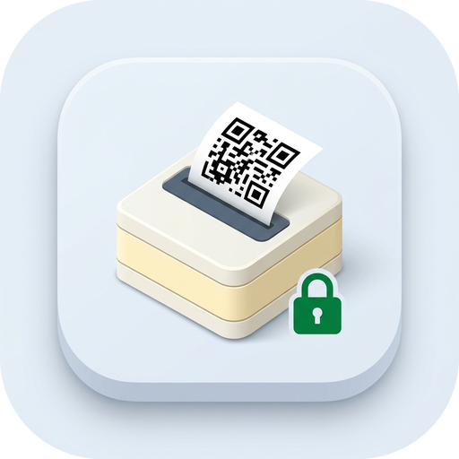
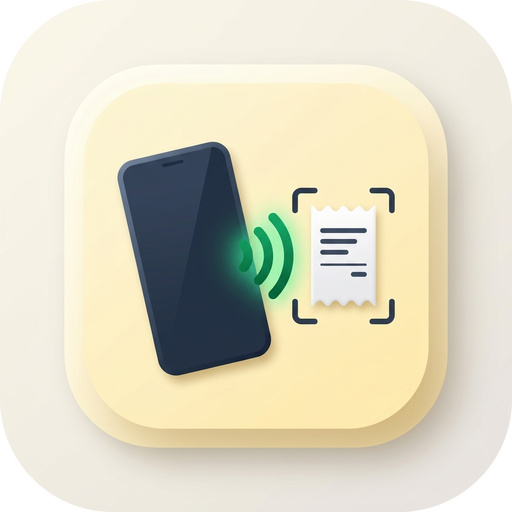
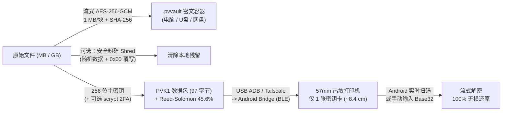

<p align="center">
  
  &nbsp;&nbsp;&nbsp;&nbsp;
  
</p>

<h1 align="center">PAPER-VOID — 热敏纸质物理密钥文件保险箱</h1>

<p align="center">
  <b>将平价 57mm 迷你热敏打印机打造成真正的物理隔离（Air-Gapped）AES-256-GCM 密钥保险箱</b><br/>
  <i>混合纸质密钥加密 • Reed-Solomon 光学纠错码（`PV-RIBBON v1`）• Android 手机实时扫码解锁</i>
</p>

<p align="center">
  <a href="README.md">English</a> &nbsp;|&nbsp; <a href="README.vi.md">Tiếng Việt</a> &nbsp;|&nbsp; <b>简体中文</b>
</p>

---

## 1. 项目简介

**PAPER-VOID** 采用 **混合纸质密钥保险箱（Hybrid Paper-Key Vault）** 架构：不再把整个文件打印到几米长的纸上，而是将 **加密密文（`.pvvault`）** 与 **印在热敏纸上的物理密钥** 彻底分离：

- 任意大小的文件（从几十 KB 到数 GB）通过 **流式 AES-256-GCM（每块 `1 MB`）** 加密为 `.pvvault` 文件，可放心存放在电脑、U 盘、NAS 或网盘中。
- 随机生成的 256 位主密钥（支持可选离线 `scrypt` 双重口令 2FA）仅打印为 **1 张约 8.4 cm（`384 × 670 px`）的实体密钥卡**：
  - **`PV-RIBBON v1` 光学码**：专为 203 DPI 热敏打印机设计，内置 **双向交织 Reed-Solomon 纠错（`RS(158, 86)`，`45.6%` 冗余）** 与 SHA-256 CTR 白化掩码——即使纸张褶皱、褪色、倾斜、暗光甚至倒置 180° 仍可精准识别。
  - **3 行人类可读 Base32 + CRC-16 校验恢复码**：附印于卡片底部，无摄像头时亦可手动输入找回文件。
- 配套 **Android 伴侣应用（`TinyPrint Bridge`）**，同时支持 **USB 数据线（ADB 自动端口转发）** 与 **局域网 / Tailscale 远程连接（`0.0.0.0:9100`）**，既可蓝牙 BLE 驱动热敏打印机，又内置全屏专属扫码界面，带有圆角缩放取景框动效及识别成功震动提示。



---

## 2. 核心特性

- **大文件流式加密（`AES-256-GCM`）**：按 `1 MB` 分块处理不占内存，`.part` 原子写入，每块独立鉴权 + 全文件 `SHA-256` 校验。
- **纯离线双因素认证（2FA，可选）**：通过 `scrypt`（`N=2^15, r=8, p=1`，128 位随机盐）对主密钥二次加密，攻击者必须**同时拿到实体纸卡并知道你的口令**才能解密。
- **极致省纸**：无论加密 50 KB 还是 10 GB 文件，始终只消耗 **1 张约 8.4 cm** 的热敏纸。
- **手机直连实时扫码（USB ADB / Tailscale）**：无需电脑摄像头，无需手动拍照再传回电脑。
- **一键启停手机端 Bridge**：可在电脑界面或 Android 通知栏随时主动开启/关闭 `TinyPrint Bridge` 服务。
- **安全粉碎（Secure Shred）**：删除原文件前先覆写随机字节与 `0x00` 并随机改名。
- **100% 离线开源**：无账号、无云端依赖、无任何遥测数据上报。

---

## 3. 支持的热敏打印机

PAPER-VOID 输出标准 **`384 px`（57mm 纸宽 / 203 DPI）** 图像，兼容多款便携热敏打印机：

| 设备分组 | 代表型号 | 协议 / 纸宽 | 支持状态 |
| :--- | :--- | :--- | :--- |
| **真机实测验证（Verified）** | **TinyPrint X5**（`MXW01` 系列） | BLE `MXW01`（`0x22 0x21`，384 px / 57mm） | ✅ **100% 完全支持**（已针对热敏头控温与走纸节奏优化） |
| **同芯片 MXW01 迷你打印机** | **MX06、MX08、MX10、MX11** 及使用 *TinyPrint / FunPrint / WalkPrint* 的蓝牙打印机（BLE UUID `AE30` / `AE01`） | BLE `MXW01`（`384 px` / 57mm） | ✅ **直接兼容**（在打印机页面修改蓝牙名称即可） |
| **经典喵喵机 / Cat Printer** | **GB01、GB02、GB03、GT01、MX05** | Classic BLE（`0x51 0x78`，384 px / 57mm） | 🟡 **通过 Classic BLE 驱动支持** |
| **任意普通打印机** | 办公激光/喷墨打印机、USB 小票机 | 导出 `384 × 670 px` PNG 密钥卡图片 | ✅ **100% 支持** |

### 运行环境要求
- **电脑端**：Windows 10/11（64 位），可直接运行独立 `PAPER-VOID.exe` 或 Python 3.12+ 源码。
- **Android 手机端** *(用于 BLE 打印与实时扫码)*：Android 8.0+（支持 BLE），USB 模式需开启 **USB 调试**，无线模式需在同一局域网或 **Tailscale** 下开放 `:9100` 端口。

---

## 4. 与其他加密方案的安全性对比

| 对比维度 | **PAPER-VOID（纸质密钥保险箱）** | ZIP / 7-Zip 密码压缩 | BitLocker / VeraCrypt | 云端密码管理器 | Google Authenticator（TOTP） | YubiKey / 硬件密钥 |
| :--- | :---: | :---: | :---: | :---: | :---: | :---: |
| **核心用途** | **物理隔离文件加密** | 口令压缩加密 | 全盘 / 加密卷保护 | 云端密码/文件托管 | 登录双因素动态码 | FIDO2 / PGP 硬件令牌 |
| **密钥是否留存硬盘或云端？** | **否**（仅存于实体纸张） | 不存盘，但弱口令易被爆破 | 存于加密卷头中 | 加密后存于第三方服务器 | 种子存于手机或云端 | 存于安全芯片中 |
| **防御木马/远控（RAT）窃取** | **极高**——没有实体纸卡，`.pvvault` 毫无意义 | 中——键盘记录器可直接截取密码 | 中——挂载期间可能被记录口令或转储内存 | 低~中——主密码或会话泄露即失守 | 不用于文件加密 | 极高（需配合外部加密软件） |
| **抗暴力破解能力** | **密码学级（`2^256` + `scrypt` 2FA）** | 取决于用户口令强度 | 极高（需强口令） | 极高 | 不适用 | 密码学级 |
| **硬件成本** | **极低（约 ¥50–¥100）** | 免费 | 免费 | 订阅制 / 免费受限 | 免费 | 较高（约 ¥350–¥700+） |
| **主要注意事项** | 热敏纸长期存放会褪色 *(见第 6 节)* | 忘记密码即永久丢失 | 忘记密码或卷头损坏即丢失 | 依赖第三方服务商 | 手机丢失且未备份有风险 | 硬件遗失或损坏成本高 |

---

## 5. 适用人群与核心价值

### 适用人群
- **数字资产与敏感隐私冷存储用户**：离线备份加密钱包助记词、SSH/PGP 私钥、重要合同、证件扫描件与私人档案。
- **开发者、运维与信息安全爱好者**：算法完全透明可审计（`AES-256-GCM` + `scrypt` + `Reed-Solomon`），无任何厂商锁定。
- **迷你热敏打印机玩家**：让百元便携小票机变身真正的物理隔离安全硬件。
- **家庭或小团队安全交接**：`.pvvault` 可公开存放在网盘或 U 盘，纸质密钥密封锁入实体保险柜，风险彻底拆分。

### 核心优势
1. **真正的物理隔离（True Air-Gap）**：即使密文 `.pvvault` 在网络上泄露，没有你口袋或保险柜里的纸卡依然无法破解。
2. **极速且低成本**：打印 1 张密钥卡约 5 秒，手机扫码解锁约 2 秒。
3. **防锁死冗余保障**：Reed-Solomon 可自动修复高达 `45.6%` 的光学污损；极端情况下仍可通过底部 **3 行 Base32 字符**手动恢复数据。

---

## 6. 热敏纸保存建议与 SSD 粉碎说明

- **热敏纸防褪色建议**：普通热敏纸在高温、日晒或摩擦下 6 个月～3 年可能变淡。长期冷存储建议：
  1. 一次打印 **2 份密钥卡**，装入避光密封袋分别存放于阴凉处；或
  2. 选用 **长效防褪色热敏纸（标称 10 年留影）**；或
  3. 用圆珠笔将卡片底部的 **3 行 Base32 恢复码** 抄写到普通纸上双保险备份。
- **SSD 固态硬盘安全粉碎说明**：覆写粉碎在机械硬盘（HDD）上效果彻底；在 SSD 上由于磨损均衡（Wear-Leveling）机制，原始块可能短暂残留直至系统执行 `TRIM`，建议配合开启系统全盘加密（如 **BitLocker**）。

---

## 7. 目录结构与快速开始

```text
├── assets/                   # 电脑端与 Android Bridge 图标
├── paper_void/               # Windows 桌面端（Python + Tkinter + OpenCV）
│   ├── app.py                # 主界面
│   ├── vault.py              # 流式 AES-256-GCM + scrypt 2FA + 密钥卡生成
│   ├── codec.py              # PV-RIBBON v1 光学编解码（Reed-Solomon 45.6%）+ 粉碎
│   ├── scanner.py            # OpenCV 5 通道解码器（图片 / 视频 / 实时帧）
│   └── printer_ble.py        # MXW01 / Classic BLE 驱动 + ADB / Tailscale 桥接客户端
├── android/                  # Android 伴侣端（TinyPrint Bridge + 实时扫码器）
│   ├── src/com/tinyprint/bridge/
│   │   ├── BleBridgeService.java
│   │   ├── BridgeActivity.java
│   │   └── ScannerActivity.java
│   └── build_and_install.ps1 # 纯 Android SDK 打包安装脚本（无需 Gradle）
├── README.md                 # English
├── README.vi.md              # Tiếng Việt
└── README.zh-CN.md           # 简体中文
```

### 从源码运行 Windows 桌面端
```powershell
pip install -r paper_void/requirements.txt
py -3.12 paper_void/app.py
```

### 编译并安装 Android Bridge APK
```powershell
powershell -ExecutionPolicy Bypass -File android/build_and_install.ps1
```
